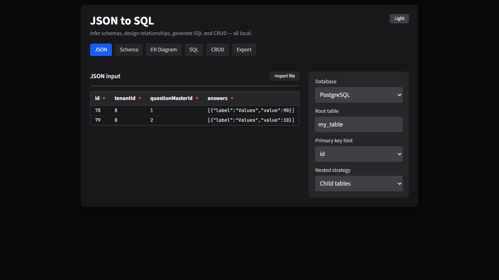

# JSON to SQL

Local-first open-source developer tool: import JSON, infer a database schema, design relationships, generate dialect-specific SQL, and export CRUD starters.

No paid APIs. No remote conversion service. Generation only — this tool never executes SQL.

## Features

- JSON import (paste or file) with validation and size/depth limits
- Schema inference with nullable/type detection and nested object handling
- Visual schema designer + ER diagram
- SQL dialects: PostgreSQL, MySQL, SQL Server, SQLite
- CREATE / DML / SELECT+JOIN / parameterized templates
- CRUD codegen: Express (JS/TS), NestJS (TS)
- Export: SQL, TypeScript interfaces, JSON Schema, CSV, ZIP bundle
- Web UI + CLI (`json2sql`)

## Quick start

```bash
npm install
npm run build:packages
npm run dev
```

Open [http://localhost:3000](http://localhost:3000).



### CLI

```bash
npm run cli -- sample.json --dialect postgres --table users --out ./out --crud express-ts
```

## Workspace layout

| Path | Role |
|------|------|
| `packages/core` | Pure TypeScript engine (parse, infer, dialects, SQL, CRUD, export) |
| `packages/cli` | Node CLI wrapping core |
| `src/app` | Next.js UI |

## Supported databases

| Dialect | CREATE | DML | Identifiers | Identity |
|---------|--------|-----|-------------|----------|
| PostgreSQL | Yes | Yes | `"ident"` | `GENERATED BY DEFAULT AS IDENTITY` |
| MySQL | Yes | Yes | `` `ident` `` | `AUTO_INCREMENT` |
| SQL Server | Yes | Yes | `[ident]` | `IDENTITY(1,1)` |
| SQLite | Yes | Yes | `"ident"` | `AUTOINCREMENT` |

## Supported code generation

| Target | Language | Artifacts |
|--------|----------|-----------|
| Express | JavaScript | DTO, service, controller, routes, app stub |
| Express | TypeScript | DTO, service, controller, routes, app stub |
| NestJS | TypeScript | module, controller, service, DTO, app module |

## Documentation

- [Architecture](docs/ARCHITECTURE.md)
- [Feature checklist](docs/FEATURE_CHECKLIST.md)
- [Security assessment](docs/SECURITY_ASSESSMENT.md)
- [Roadmap](docs/ROADMAP.md)
- [Open-source release checklist](docs/OSS_RELEASE_CHECKLIST.md)
- [Contributing](CONTRIBUTING.md)
- [Security policy](SECURITY.md)

## Scripts

| Script | Purpose |
|--------|---------|
| `npm run dev` | Build core + start Next.js |
| `npm test` | Vitest unit tests (core) |
| `npm run test:e2e` | Playwright smoke test |
| `npm run build` | Build packages + Next static export |
| `npm run cli` | Run CLI |

## License

MIT — see [LICENSE](LICENSE). Confirm ownership of logos/assets before publishing under your org name.
